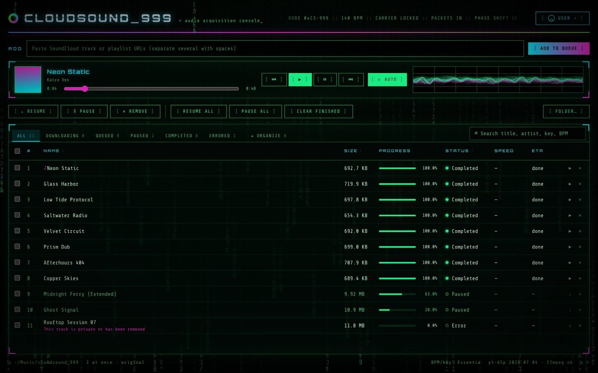
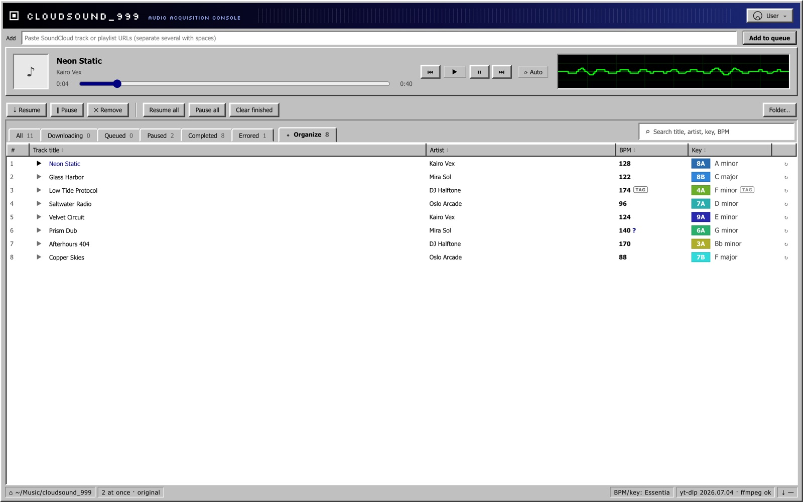
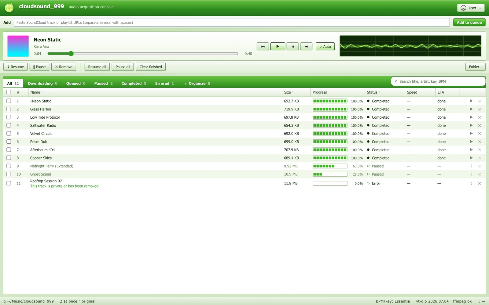
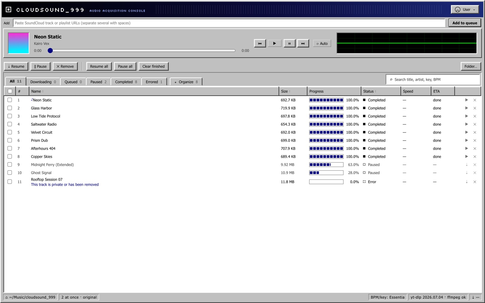
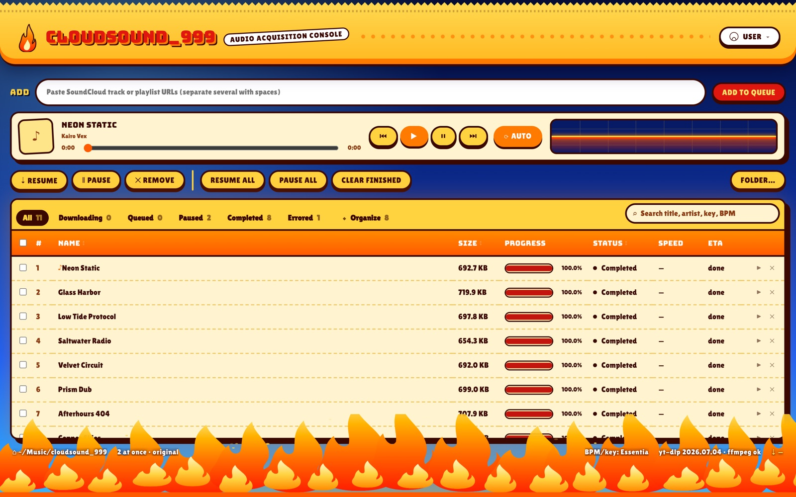
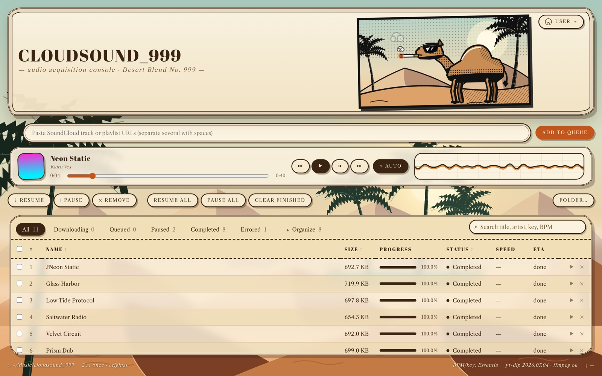
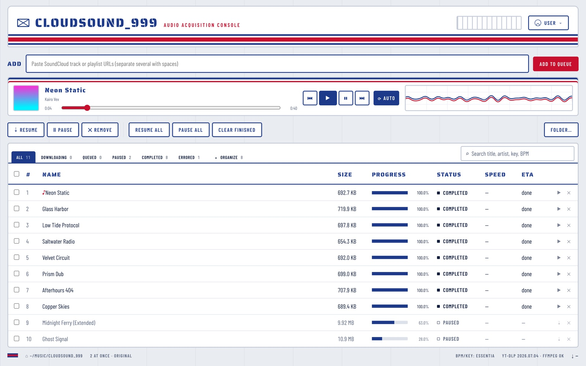
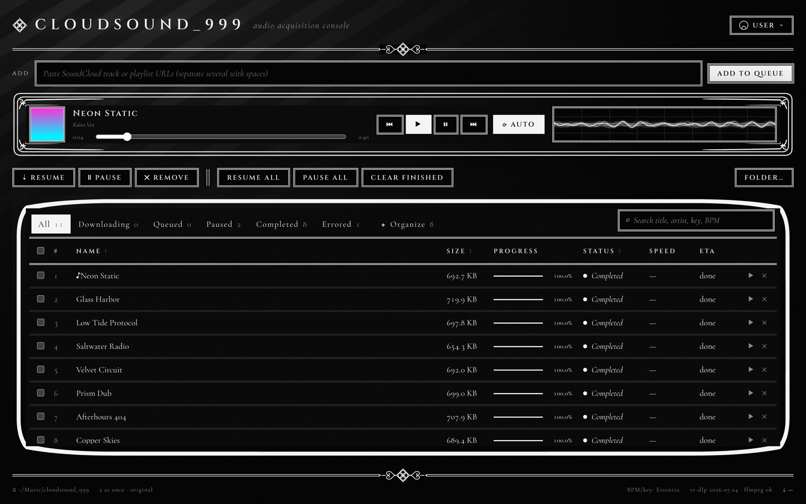

# cloudsound_999

A local, qBittorrent-style acquisition console and player for SoundCloud audio. Paste track or playlist URLs and they go into a transfer list. `yt-dlp` saves the audio into a folder you choose, with live progress, speed, ETA, and pause / resume / remove.

Everything runs on your machine. The server listens only on `127.0.0.1`.





## Install (macOS)

1. Install [Homebrew](https://brew.sh), then run `brew install python yt-dlp ffmpeg`.
2. Open `cloudsound_999-<version>.dmg` and drag **cloudsound_999** to **Applications**.
3. On first open, macOS blocks the app because it isn't notarized. Go to System Settings → Privacy & Security and click **Open Anyway**.

The first launch takes about a minute while the app sets up its Python packages. BPM/key analysis adds Essentia in the background. On other systems, run from source with `./run.sh` (see below).

> **Use responsibly.** Only download audio you have the rights to: tracks the artist has made downloadable, Creative Commons–licensed work, or your own uploads. Respect artists and SoundCloud's terms.

## Requirements

| Tool | Why | Install (macOS) |
|---|---|---|
| Python 3.9+ | runs the local server | `brew install python` |
| yt-dlp | does the downloading | `brew install yt-dlp` |
| ffmpeg | audio conversion, metadata and cover-art embedding | `brew install ffmpeg` |

Or install both tools at once:

```bash
brew install yt-dlp ffmpeg
```

**BPM and key analysis** runs in the background after each download finishes, one track at a time at low priority.
- **Tags first:** if a DJ tool has written BPM or key into the file, those values are used. That covers Mixed In Key, rekordbox, Serato, Traktor and Mixxx: ID3 `TBPM`/`TKEY`, the M4A `tmpo` atom and `initialkey`, Vorbis `BPM`/`INITIALKEY`, in Camelot, Open Key or note notation. They're marked **TAG**. For the most accurate keys, run your downloads through Mixed In Key, then select them and choose *Analyse BPM/key again* from the right-click menu.
- **Otherwise, detection:**
  - Tempo comes from Essentia's `RhythmExtractor2013`, cross-checked with `PercivalBpmEstimator`.
  - Key comes from `KeyExtractor` with three profiles voting: `bgate` (general), `edma` (electronic) and `shaath` (KeyFinder's).
  - `?` marks results the detectors disagreed on.
- **BPM range** (Settings): detected tempos are doubled or halved to fit the range, like DJ software, which fixes most half-time and double-time readings. Presets: 70–140 hip-hop, 78–155 general (default), 88–175 drum & bass, 100–200 hardcore, or off. Values set by hand or read from tags are never changed.
- On first launch the app adds [Essentia](https://essentia.upf.edu) (about 60 MB) to its own Python virtualenv. Nothing is installed system-wide.
- If Essentia has no build for that Mac or Python version (for example older Intel Macs), the app uses a simpler built-in analyser based on NumPy. It's less accurate, especially for tempo.
- Long files such as mixes or tapes are analysed on their first 8 minutes and get one overall value.
- The status bar shows which analyser is active.

The app checks for `yt-dlp` and `ffmpeg` at startup. If either is missing, it shows a banner with the install command. It never installs them for you. Without ffmpeg, downloads still work, but you get the original stream with no conversion or embedded art.

Keep yt-dlp current, since SoundCloud changes occasionally break older versions:

```bash
brew upgrade yt-dlp
```

## Run

```bash
./run.sh
```

The first run creates `.venv/` and installs FastAPI and uvicorn into it. The script then starts the server and opens http://127.0.0.1:9990.

- `PORT=8123 ./run.sh` uses a different port.
- `NO_BROWSER=1 ./run.sh` starts without opening a browser.
- Stop it with `Ctrl+C`.

### Mac app (native window)

```bash
macapp/build_app.sh
```

This builds `~/Applications/cloudsound_999.app`, a native Swift/WebKit app with its own window, so no browser is involved. It needs the Xcode Command Line Tools (`xcode-select --install`) to compile. The result is a universal binary for Apple Silicon and Intel and runs on macOS 12 or later. You can pass a different destination folder as the first argument.

- **Opening it** starts the bundled server in the background and shows the console in the window. On a first launch it sets up its Python packages, which takes about a minute.
- **⌘Q or closing the window** stops the server. If downloads are running, it asks first. Unfinished downloads come back as *Paused* next time.
- **Menus:** File → Add URLs (⌘L), Choose Download Folder (⌘O, the native picker), Open Download Folder (⇧⌘O). View → Skin (⌘1–⌘7) and Reload (⌘R). Settings (⌘,). Help → Show Server Log.
- **Dock badge:** shows the number of active downloads.
- **Drop links to queue:** drag a SoundCloud link (from a browser's address bar, a page, or a `.webloc` file) onto the Dock icon or the window, and it's added to the queue. If the app isn't running, it opens first. Selected text with links also works through the right-click Services menu → **Add to cloudsound_999 Queue**. To accept links on the Dock icon, the app registers as able to open web links. That puts it in macOS's list of possible default browsers. It never becomes the default unless you choose it.

The app is self-contained: it carries a copy of the code. Each user's settings, queue, Python virtualenv and `server.log` live in `~/Library/Application Support/cloudsound_999`, and deleting that folder resets the app. Running `./run.sh` from this folder still uses `.state/` and `.venv/` here, so the two setups stay separate.

After you edit the code, run `macapp/build_app.sh` again to update the app.

### Making a release

```bash
macapp/make_release.sh
```

This reads the version from `VERSION` and the notes from that version's section in `CHANGELOG.md`. It writes to `dist/release-<version>/`:
- a `.dmg` (drag to Applications)
- a `-mac.zip` of the app
- a `-source.zip`
- `SHA256SUMS.txt`
- `RELEASE_NOTES.md`

To publish, upload those files to a GitHub release or similar.

### Sharing it with friends (macOS)

```bash
macapp/make_share_zip.sh
```

This creates `dist/cloudsound_999-mac.zip` (~250 KB), which contains the app and `READ ME FIRST.txt`. Send it by AirDrop, Drive, email or similar. Recipients need:

1. Homebrew, then `brew install python yt-dlp ffmpeg`.
2. A one-time "Open Anyway" in System Settings → Privacy & Security. The app is only ad-hoc signed, not notarized. Skipping this step would require an Apple Developer account ($99/yr) to sign and notarize the app.

The first launch takes about a minute while the app installs its Python packages.

## Using it

- **Add:** paste one or more SoundCloud URLs, separated by spaces, and press **Add to queue**. Playlists, sets, and profile pages expand into one row per track. Rows show *Resolving…* while that happens.
- **Player deck** (under the Add bar): plays your completed tracks in list order with ⏮ ▶ ⏸ ⏭.
  - It shows the track's album art (the cover embedded in the file), the title, the uploader, and a seek slider.
  - **⟳ Auto** toggles auto-play. When it's on, the next track starts when one ends; when it's off, playback stops after each track. The setting is remembered.
  - A live oscilloscope traces the audio in each skin's own style: phosphor green with trails (Matrix), a green LCD (LymeWire), a stepped pixel trace (Napsterr), a flame-filled trace (HotFries), an ink line with an off-register print shadow (JoeKool), a blue-and-red livery line (POSTAL), and a thin white bloom (Noir).
  - Space toggles play/pause, and the media keys work too. Each finished row has a ▶ button, and double-clicking a finished row plays it. The track playing is marked with ♪.
- **Drag & drop:** drop links anywhere on the window to queue them.
- **Transfer list:** each row shows name, size, progress, status, speed, and ETA. Click to select, ⌘/Ctrl-click or Shift-click to select several, and right-click for a context menu. Double-click toggles pause/resume, and plays a finished track. **Show in Finder** is in the right-click menu.
- **Pause / Resume** (⇣ / ‖ buttons, for downloads): pausing suspends the running `yt-dlp` process group (SIGSTOP), including any ffmpeg child, and resume continues it exactly where it left off. If the app was restarted, unfinished rows come back as *Paused*. Resuming them starts a fresh `yt-dlp --continue`, which picks up the `.part` / fragment files already on disk.
- **Remove:** this asks for confirmation. Tick **Also delete downloaded / partial files** to remove that row's `.part`, fragment, thumbnail, and finished files from disk too. Keyboard: `Delete`.
- **Status tabs** (top of the transfer list): All · Downloading · Queued · Paused · Completed · Errored · **Organize**.
- **Organize** (for DJs): your finished tracks with **Track title, Artist, BPM and Key**.
  - Key is shown as a colour-coded Camelot badge (e.g. `8A`) plus the key name. Sorting by Key orders tracks around the Camelot wheel, so harmonically compatible tracks sit next to each other.
  - Click a column header to sort (▲ ascending, ▼ descending, a third click restores the original order). Name, Size and Status sort in the transfer list too.
  - Analysis can read fast tracks at half speed (for example 87 instead of 174 for drum & bass). Hover a BPM and use **½** / **×2**, or double-click it to type a value; edited BPMs are marked ✎. **↻** analyses a track again.
  - Double-click a row to play it. The player follows the order you see, sorted and filtered.
- **Search** (⌘F, Esc clears): every word must match.
  - Words match the title, artist or key.
  - A number like `128` matches BPM within ±1.5, and `120-130` is a BPM range.
  - `8A` matches a Camelot key. `Fm`, `F#min`, `Abmaj` or `F minor` match a musical key.
  - Combine them, e.g. `morphics 84-90 minor`.
- **Settings** (user menu → Settings…):
  - Download folder: use **Browse…** for the native macOS picker, or type a path.
  - Simultaneous downloads: 1–8.
  - Speed limit per download in KB/s (0 = unlimited), passed to yt-dlp as `--limit-rate`.
  - Audio format: *Original* (no re-encode), MP3, M4A, Opus, FLAC, or WAV.
  - Embed metadata and cover art on or off.

  Settings persist in `.state/settings.json`, and the queue persists in `.state/jobs.json`.
- **Files** are named `Uploader - Title [id].ext`.

## Skins

Open the **User** menu in the top-right and choose a skin (the menu closes once you pick one). The choice is remembered in `localStorage`. All skins share the same markup and are CSS-variable layers with per-skin layout tweaks.

| Skin | Look |
|---|---|
| **Matrix** (default) | Y2K rave / techno terminal: falling green glyph rain, neon cyan-magenta chrome type with a glitch flicker, HUD corner brackets, CRT scanlines, and a scrolling ticker. |
| **LymeWire** | Early-2000s P2P client: a juicy half-lime emblem, lime gradients, beveled XP-era buttons, a dense striped grid, and segmented progress bars. |
| **Napsterr** | Late-90s Win98 client: grey bevelled chrome, a black-to-navy header, pixel type, and status filters as a tab strip. |
| **HotFries** | Snack bag on fire: an electric-blue gradient with animated flames and embers rising from the bottom, a flame mark, a crimped heat-seal header, chunky display type, and sticker buttons. |
| **JoeKool** | Humid oasis: a hazy sky, palm trees and sharp, knife-edged dunes behind rounded, playful double-ruled panels and pill buttons. An original camel drawn as an inked graphic-novel panel, in dark shades with a smouldering cigarette, sits in the header; its smoke speeds up while downloads run. |
| **POSTAL** | Mail van: white body panels, blue/red/blue livery stripes, and stencil type. |
| **Noir** | All black with white highlights. Every separator is a double rule with Venetian scrollwork: quatrefoil centrepieces on the rules and curled corners on the panels, set in Cinzel and Cormorant, with a faint film grain. |

The skins are pastiches built from color, type, texture, layout, and original illustration. They use no trademarked logos, brand characters, or official seals. All artwork, including the JoeKool camel, the HotFries flames and the LymeWire lime, is original inline SVG and CSS.

<table>
<tr><td><br><b>LymeWire</b></td><td><br><b>Napsterr</b></td></tr>
<tr><td><br><b>HotFries</b></td><td><br><b>JoeKool</b></td></tr>
<tr><td><br><b>POSTAL</b></td><td><br><b>Noir</b></td></tr>
</table>

## How it works

```
browser (static/index.html + app.js + app.css)
   │  POST /api/add | pause | resume | remove | settings | choose-folder
   │  GET  /api/events  ← Server-Sent Events: full queue snapshot on every change
   │  GET  /api/audio/{id}  ← finished file for the built-in player (Range requests)
   │  GET  /api/art/{id}    ← embedded cover art, extracted once with ffmpeg and cached in .state/art/
   │  POST /api/meta        ← set a BPM by hand, or re-analyse a track
   │  POST /api/reanalyze   ← re-read tags / re-detect BPM and key for several tracks
   ▼
server.py (FastAPI)
   ├─ scheduler thread: starts queued jobs up to the concurrency limit
   ├─ one `yt-dlp` process per job (own process group → SIGSTOP/SIGCONT for pause)
   │    --progress-template "download:CSPROG\t…"   ← parsed for bytes/total/speed/ETA
   │    -x --audio-format … --embed-metadata --embed-thumbnail --continue
   └─ `yt-dlp --flat-playlist -J` to expand playlists into rows
```

## Files

```
cloudsound_999/
├─ run.sh            one-command launcher
├─ server.py         FastAPI backend + yt-dlp job manager + analysis worker
├─ analyze.py        BPM / key analysis of one file (tags, Essentia, or a NumPy fallback)
├─ VERSION           release version (used by the server and the app build)
├─ CHANGELOG.md      release notes
├─ macapp/           native app source, build_app.sh, make_share_zip.sh, make_release.sh
├─ requirements.txt  fastapi, uvicorn
├─ static/           index.html, app.js, app.css (all seven skins)
└─ .state/           settings.json, jobs.json (created at runtime)
```

## Troubleshooting

- **"ERROR: … HTTP Error 404" or no formats found:** the track may be private, removed, or region-locked, or yt-dlp may be out of date. Run `brew upgrade yt-dlp`.
- **Go+ / preview-only tracks:** SoundCloud serves only a 30-second preview to anonymous clients. yt-dlp saves just that preview.
- **Port in use:** `PORT=9991 ./run.sh`.
- **Start over:** stop the app and delete `.state/`.

## Third-party software

cloudsound_999 doesn't bundle these tools. It uses the copies installed on the user's Mac, and installs its Python packages into its own virtualenv at first launch.

| Component | Used for | License |
|---|---|---|
| [yt-dlp](https://github.com/yt-dlp/yt-dlp) | downloading | Unlicense |
| [FFmpeg](https://ffmpeg.org) | conversion, tags, cover art, decoding for analysis | LGPL/GPL |
| [FastAPI](https://fastapi.tiangolo.com) / [Uvicorn](https://www.uvicorn.org) | local server | MIT / BSD-3 |
| [Essentia](https://essentia.upf.edu) | BPM and key detection | AGPL-3.0 |
| [NumPy](https://numpy.org) | fallback analyser | BSD-3 |

## License

[MIT](LICENSE). cloudsound_999 is not affiliated with SoundCloud or with any brand its skins nod to.
